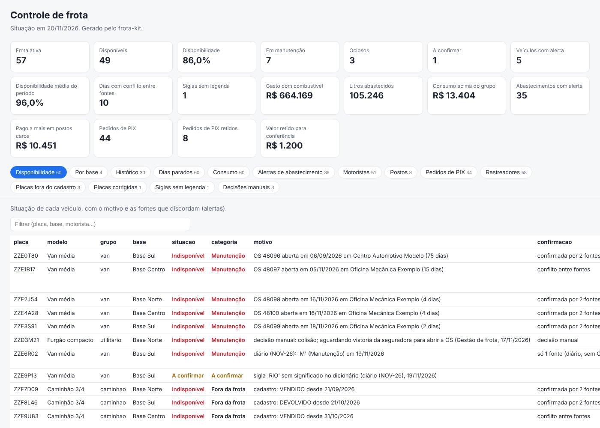
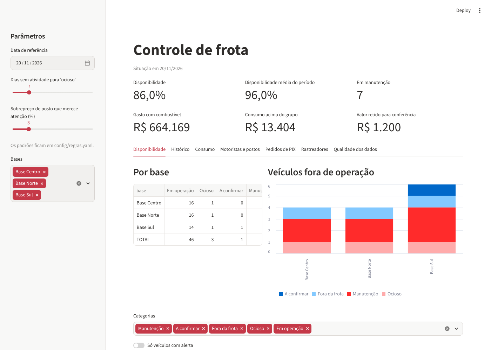
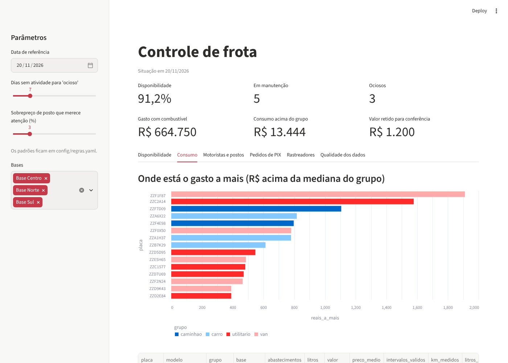
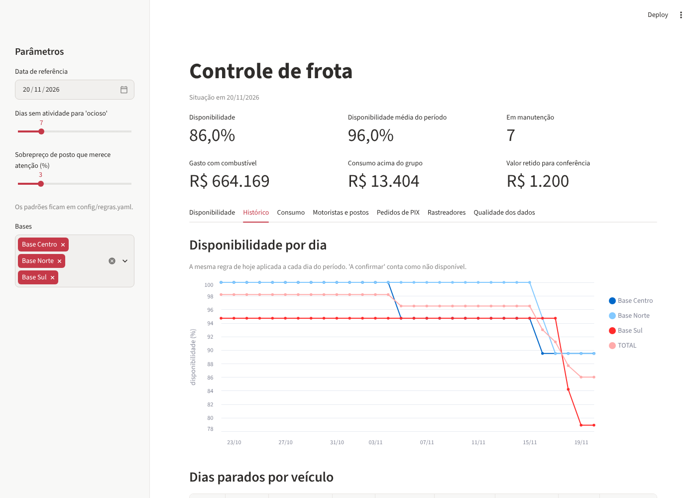

# frota-kit — fleet control from any data source

*[Versão em português](README.pt-BR.md)*

A Python toolkit that answers, every day and with data, the questions every fleet operation asks:

1. **Which vehicles are available today — and why aren't the others?**
2. **How much fuel does each vehicle really use, and where is fuel money being wasted?**
3. **Can this fuel reimbursement request be paid?**

It works with what a company already has: an **ERP** (via SQL), fuel-card and telematics **APIs**,
**spreadsheets**, even **WhatsApp forms**. Every source is mapped to a
[canonical data model](docs/modelo-de-dados.md) and the rules run on top of it — swapping a
spreadsheet for an ERP means editing a YAML file, not the code.



## What it does

| Module | Question | How |
| --- | --- | --- |
| **Availability** | Is the vehicle available? Why not? | Ordered, configurable rules (manual decision → decommissioned → open work order → maintenance code in the daily log → unknown code → idle → operating), always with the **reason** and **how many sources confirm it**. Sources that disagree become **alerts**: "work order open but the vehicle refuelled afterwards", "maintenance only in the daily log: open a work order?", "75 days in the workshop". |
| **History** | How did availability evolve this month? | The same rule applied to every day: series per site, days stopped per vehicle and **conflict days** (drove on a day it was "in maintenance"). |
| **Daily logs and plates** | Can the spreadsheet be trusted? | Reads plate × day grids wherever they sit in the sheet; translates codes with an editable dictionary (unknown codes become "to confirm" plus a to-do list); fixes O↔0 and I↔1 by position and **suggests** the right plate for typos, never linking on its own. |
| **Manual decisions** | What about cases no rule covers? | A CSV with plate, action (link, ignore, force status), reason, **who** and **when** — applied on every later run and fully traceable. |
| **Fuel consumption** | What is the real km/L? How much is overspent? | km/L **between full tanks**, accumulated per vehicle with an error margin; compared with the vehicle-group median to estimate money overspent. |
| **Fuel data quality** | Can this record be trusted? | Duplicates, missing/decreasing odometer, extra digit, typo vs. distance driven without a recorded refuel, litres above tank capacity, "full tank" that wasn't full (**saw-tooth pattern**). |
| **Drivers and stations** | Is it the driver or the vehicle? Is the station overpriced? | Each driver compared with **other drivers of the same vehicles**, with a bootstrap confidence interval. Station price vs. the median in the same city, fuel and month. |
| **Reimbursement requests** | Can I pay it? | Resent forms, copied odometer, wrong or unknown plate, vehicle in the workshop, missing payment key. |
| **GPS trackers** | Where is each vehicle? | Latest position across vendors, plate parsed from nicknames ("Van 03 - ABC-1D23"), optional reverse geocoding. |

Outputs: a single-file **HTML report** (opens in any browser, no server), an **Excel** workbook
and an interactive **Streamlit** dashboard.





## Quick start (synthetic data)

```bash
python -m venv .venv && source .venv/bin/activate     # Windows: .venv\Scripts\activate
pip install -r requirements.txt

python -m frotakit exemplo        # generates a synthetic 60-vehicle fleet in dados_exemplo/
python -m frotakit rodar          # -> saida/relatorio.html and saida/relatorio.xlsx
streamlit run app/streamlit_app.py
pytest                            # 36 tests
```

The sample fleet has problems planted on purpose, and the toolkit finds all of them: availability
dropping from 98.2% to 86.0% over 30 days, with one vehicle stuck 75 days in a workshop, a work
order left open while the vehicle drove for 10 days, a maintenance recorded only in the daily log
and an unknown log code; misspelled plates corrected or flagged with a suggestion; R$ 13.4k of
fuel above the group median; one station charging 7.3% above the city median; five "full tanks"
that weren't; one driver using 15% more fuel than others on the same vehicles (95% CI −16% to
−14%); 8 of 44 payment requests held for review.

## Using it with your own data

Copy `config/fontes.yaml` to `config/fontes.local.yaml` (git-ignored) and, for each entity, say
where to read it from and how the columns are named — see [docs/integracao.md](docs/integracao.md).
Business rules (km/L ranges per vehicle group, idle threshold, which work-order statuses count as
open, rule order) live in `config/regras.yaml`. The method behind each number is in
[docs/metodologia.md](docs/metodologia.md).

**Deploying it?** Start with the [technical note](docs/nota-tecnica.md) (Portuguese): what each file
does, what to configure, common pitfalls and a step-by-step rollout. What it does *not* solve, and the
people and technology a company needs: [limitations and recommendations](docs/limitacoes-e-recomendacoes.md).

Code, comments and docs are in Portuguese, the language of the operations teams it was built for.

## Background

It grew out of my internship at a Brazilian last-mile carrier with about a thousand vehicles.
The fleet was managed across dozens of spreadsheets, vendor portals and WhatsApp groups, and I was
the only person working with data: turning those raw sources into clean information for
operational decisions. Those solutions were tied to that company; this toolkit is the rewrite meant for any
operation. The story is in [docs/estudo-de-caso.md](docs/estudo-de-caso.md).

## Security

No real data (plates `ZZ…`, "Motorista 07", zeroed tax IDs). Secrets only in `.env`
(git-ignored), referenced in YAML as `${VARIABLE}`. Everything runs locally.

## Author

Matheus Ramos Amorim dos Santos — [GitHub](https://github.com/matheusdadosrj) · [e-mail](mailto:matheus.dadosrj@gmail.com)

## License, citation and "tell me you use it"

frota-kit is **open source under the [Apache License 2.0](LICENSE)**: anyone can use, modify and
distribute it, including commercially. Redistributions and derivative works must keep the
[NOTICE](NOTICE) file, which credits the author.

Not required, but it means a lot: if you use it, [tell me how](../../issues/new?template=conte-como-usa.md)
or [send me an e-mail](mailto:matheus.dadosrj@gmail.com); to cite it, use GitHub's **"Cite this repository"**
button (from [CITATION.cff](CITATION.cff)).
