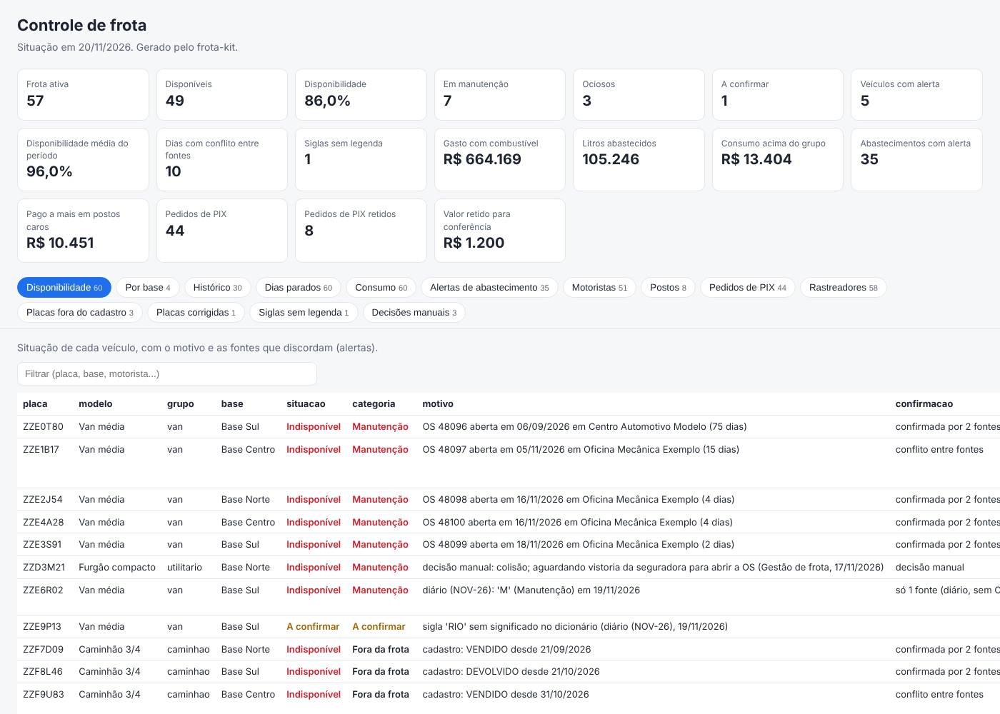
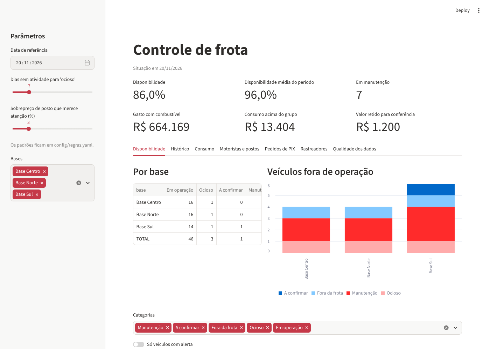
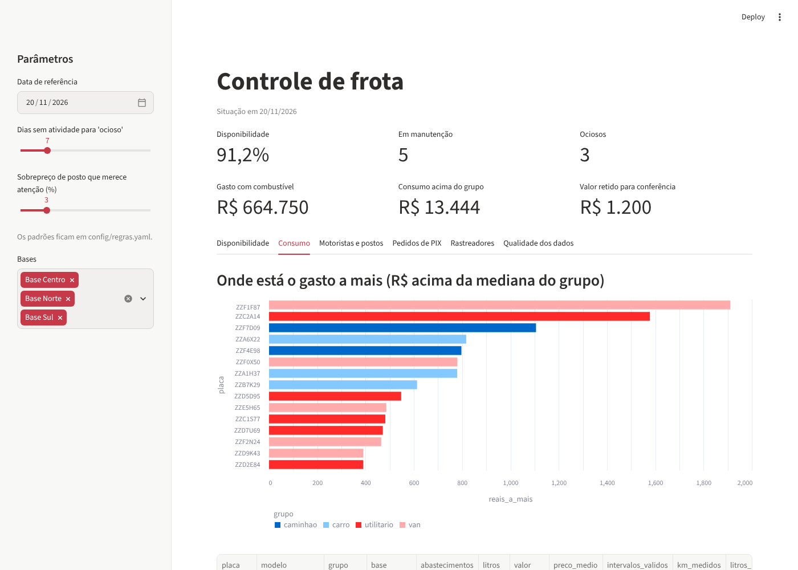
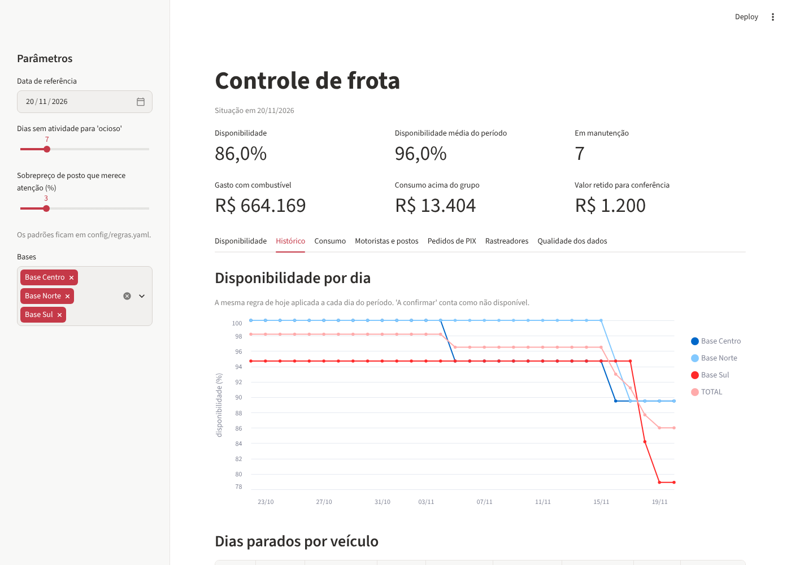

# frota-kit — controle de frota a partir de qualquer fonte

*[English version](README.md)*

Kit em Python para responder, com dados e todo dia, as perguntas que toda operação de frota faz:

1. **Quais veículos estão disponíveis hoje — e por que os outros não estão?**
2. **Quanto cada veículo realmente consome, e onde está o desperdício de combustível?**
3. **Esse pedido de pagamento de abastecimento pode ser pago?**

Funciona com o que a empresa já tem: **ERP** (via SQL), **APIs** de cartão combustível e
telemetria, **planilhas** (inclusive o diário de bordo em grade placa × dia) e até **formulários
de WhatsApp**. Cada fonte é convertida para um
[modelo de dados canônico](docs/modelo-de-dados.md) e as regras rodam em cima dele; trocar uma
planilha por um ERP é mudar um arquivo YAML, não o código.



## O que ele entrega

| Módulo | Pergunta | Como |
| --- | --- | --- |
| **Disponibilidade** | O veículo está disponível? Por quê? | Regras em ordem e configuráveis (decisão manual → baixa no cadastro → OS aberta → sigla de manutenção no diário → sigla desconhecida → ocioso → em operação), sempre com o **motivo** e **quantas fontes confirmam**. Fontes que discordam viram **alerta**: "OS aberta, mas abasteceu depois", "manutenção só no diário: abrir OS?", "na oficina há 75 dias". |
| **Histórico** | Como a disponibilidade evoluiu no mês? | A mesma regra aplicada a cada dia: série por base, dias parados por veículo e **dias com conflito** (rodou num dia em que constava em manutenção). |
| **Diário de bordo e placas** | Dá para confiar na planilha? | Lê a grade placa × dia onde quer que esteja na aba; traduz siglas por um dicionário editável (sigla nova vira "A confirmar" e entra numa lista de pendências); corrige O↔0 e I↔1 pela posição e **sugere** a placa certa para erros de digitação, sem ligar nada sozinho. |
| **Decisões manuais** | E o caso que nenhuma regra resolve? | Um CSV com placa, ação (ligar, ignorar, forçar situação), motivo, **quem** e **data**: vale nas rodadas seguintes e fica rastreável. |
| **Consumo** | Qual o km/L real? Quanto se gasta a mais? | km/L **entre tanques cheios**, acumulado por veículo com margem de erro; comparação com a mediana do grupo e estimativa de R$ gastos a mais. |
| **Qualidade do abastecimento** | O registro é confiável? | Registro em dobro, odômetro ausente/que volta/com dígito a mais, erro de digitação × trecho rodado sem abastecer, litros acima do tanque, "tanque cheio" que não encheu (**padrão serrote**). |
| **Motoristas e postos** | É o motorista ou o veículo? O posto é caro? | Motorista comparado com **outros motoristas nos mesmos veículos**, com intervalo de confiança (bootstrap). Posto comparado com a mediana da mesma cidade, combustível e mês. |
| **Pedidos de PIX** | Posso pagar? | Reenvio, odômetro copiado, placa errada ou fora do cadastro, veículo na oficina, sem chave PIX. |
| **Rastreadores** | Onde está cada veículo? | Última posição entre vários fornecedores, placa extraída de apelidos ("Van 03 - ABC-1D23"), geocodificação reversa opcional. |

Saídas: **relatório HTML** de arquivo único (abre em qualquer navegador, sem servidor),
**Excel** com uma aba por tabela e um **painel Streamlit** com filtros.





## Rodar em 1 minuto (dados fictícios)

```bash
python -m venv .venv && source .venv/bin/activate     # Windows: .venv\Scripts\activate
pip install -r requirements.txt

python -m frotakit exemplo        # gera uma frota fictícia de 60 veículos em dados_exemplo/
python -m frotakit rodar          # -> saida/relatorio.html e saida/relatorio.xlsx
streamlit run app/streamlit_app.py
pytest                            # 36 testes
```

A frota de exemplo tem problemas plantados de propósito, e o kit encontra todos:

```
Frota ativa                      57
Disponibilidade                  86,0%   (era 98,2% há 30 dias; média do período 96,0%)
Em manutenção                    7       (1 há 75 dias, 1 com a OS esquecida aberta, 1 só no diário, 1 por decisão manual)
A confirmar                      1       (sigla "RIO" sem legenda no diário)
Dias com conflito entre fontes   10      (o veículo da OS esquecida rodou 10 dias "em manutenção")
Placas no diário                 1 corrigida (O no lugar de 0), 1 com sugestão, 1 ligada por decisão
Consumo acima do grupo           R$ 13.404
Pago a mais em postos caros      R$ 10.451   (Posto Delta: +7,3% sobre a mediana da cidade)
Abastecimentos com alerta        35      (5 "cheios" que não encheram, 2 em dobro, ...)
Pedidos de PIX retidos           8 de 44
Motorista 07: consome 15% mais que os outros nos mesmos veículos (IC 95%: -16% a -14%)
```

## Usar com os dados da sua empresa

1. Copie `config/fontes.yaml` para `config/fontes.local.yaml` (fica fora do Git).
2. Para cada entidade, diga de onde ler e como as colunas se chamam na sua fonte:

```yaml
ordens_servico:
  tipo: sql
  conexao: ${ERP_URL}                          # definido no .env
  consulta: SELECT * FROM vw_frota_ordens_servico

abastecimentos:
  tipo: api
  url: https://api.seu-cartao-frota.com/v1/transacoes
  token: ${CARTAO_FROTA_TOKEN}
  registros_em: data
  paginacao: {parametro: page, tamanho_parametro: size, tamanho: 200}
  colunas: {licensePlate: placa, date: data_hora, liters: litros, odometer: odometro, fullTank: tanque_cheio}
```

3. Ajuste as regras em `config/regras.yaml` (faixas de km/L por grupo, dias para "ocioso",
   status de OS que contam como aberta, ordem das regras de disponibilidade...) e, se usar diário
   de bordo, as siglas em `config/dicionario_status.csv`.
4. `python -m frotakit validar --fontes config/fontes.local.yaml` e depois `rodar`.

**Vai implantar?** Comece pela [nota técnica](docs/nota-tecnica.md): o que cada arquivo faz, o que
configurar, onde prestar atenção e a implantação passo a passo. Antes de prometer resultados, leia
[limitações e recomendações](docs/limitacoes-e-recomendacoes.md): o que o kit não resolve e quem e o
que a empresa precisa ter.
Guia completo, com exemplos de ERP, planilha e API: [docs/integracao.md](docs/integracao.md).
Como cada número é calculado: [docs/metodologia.md](docs/metodologia.md).

## Estrutura

```
frotakit/
  modelo.py            modelo canônico, conversão de tipos e correção de placas
  adaptadores/         arquivo (CSV/Excel), grade (placa x dia), sql (ERP), api (REST/OAuth2), whatsapp
  disponibilidade.py   situação + motivo + confirmação + alertas; histórico dia a dia
  diario.py            dicionário de siglas e siglas pendentes
  decisoes.py          decisões manuais (ligar, ignorar, forçar situação)
  consumo.py           km/L entre tanques cheios, qualidade do dado, desperdício
  analise.py           motoristas (bootstrap) e postos (sobrepreço)
  solicitacoes.py      conferência de pedidos de pagamento
  rastreamento.py      última posição, placa a partir de apelido, geocodificação
  pipeline.py          roda tudo; relatorio.py gera HTML e Excel
app/streamlit_app.py   painel interativo
config/                fontes.yaml (de onde vem o dado), regras.yaml (regras de negócio), dicionario_status.csv
exemplos/              gerador da frota fictícia
tests/                 regras, adaptadores e ponta a ponta
docs/                  modelo de dados, integração, metodologia e estudo de caso
```

## De onde veio

Nasceu do meu estágio numa transportadora de last mile com cerca de mil veículos. A frota era
controlada em dezenas de planilhas, portais de fornecedores e grupos de WhatsApp, e eu era o único
na área de dados: responsável por transformar esses dados brutos em informação tratada para a
tomada de decisão.
As soluções de lá eram presas àquela realidade; este kit é a versão reescrita para servir a
qualquer operação. A história, os problemas e o que funcionou estão em
[docs/estudo-de-caso.md](docs/estudo-de-caso.md).

## Segurança

- Nenhum dado real: placas `ZZ…`, "Motorista 07", "Posto Delta", CNPJs zerados.
- Senhas e tokens só no `.env` (no `.gitignore`); no YAML aparecem como `${VARIAVEL}`.
- O painel e o relatório rodam localmente; nenhum dado sai da máquina (a geocodificação, que
  consulta o OpenStreetMap, é opcional e desligada por padrão).

## Autor

Matheus Ramos Amorim dos Santos — [GitHub](https://github.com/matheusdadosrj) · [e-mail](mailto:matheus.dadosrj@gmail.com)

## Licença, citação e "me conte que usa"

O frota-kit é **código aberto sob a [Licença Apache 2.0](LICENSE)**: qualquer pessoa ou empresa
pode usar, modificar e distribuir, inclusive comercialmente. Em troca, quem redistribuir o kit ou
um trabalho derivado dele deve manter o arquivo [NOTICE](NOTICE), que credita o autor.

Não é obrigatório, mas faz diferença para mim:

- **Usa o kit?** [Conte como usa](../../issues/new?template=conte-como-usa.md) (leva 2 minutos) ou
  me mande um [e-mail](mailto:matheus.dadosrj@gmail.com). Com a sua permissão, o nome entra na lista abaixo.
- **Vai citar** num relatório, TCC ou artigo? Use o botão **"Cite this repository"** do GitHub
  (gerado a partir do [CITATION.cff](CITATION.cff)) ou:

  > SANTOS, Matheus Ramos Amorim dos. **frota-kit**: controle de frota a partir de qualquer fonte. Versão 1.0.0. [S. l.], 2026. Software. Disponível em: https://github.com/matheusdadosrj/frota-kit.

### Quem usa

*Seja o primeiro: [conte como você usa](../../issues/new?template=conte-como-usa.md).*
