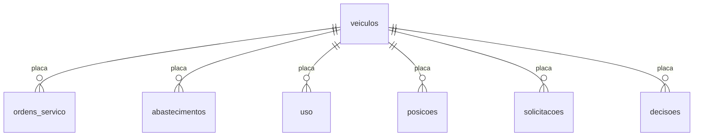

# Modelo de dados canônico

Toda fonte é convertida para estas 7 tabelas antes de qualquer regra rodar. Obrigatórias em **negrito**;
as demais podem faltar (a coluna fica vazia e as regras que dependem dela simplesmente não disparam).

Tipos aceitos na entrada: números no padrão brasileiro (`1.234,56`) ou internacional, datas `dd/mm/aaaa` ou
ISO (`aaaa-mm-dd`), booleanos como `S/N`, `Sim/Não`, `1/0`, `Ligado/Desligado`.

## `veiculos`

Cadastro da frota: uma linha por veículo. Usada em: disponibilidade, consumo (grupo e tanque), conferência de pedidos.

| coluna | tipo | observação |
| --- | --- | --- |
| **placa** | texto | normalizada e corrigida pela posição (O→0, I→1...) |
| modelo | texto |  |
| grupo | texto | carro, utilitario, van, caminhao (chaves de consumo.grupos no regras.yaml) |
| combustivel | texto |  |
| capacidade_tanque | numero | litros |
| base | texto |  |
| status_cadastro | texto | ativo, vendido, devolvido, sinistro... (lista em disponibilidade.status_fora_da_frota) |
| data_status | data |  |

## `ordens_servico`

Ordens de serviço de manutenção (ERP, sistema de frota ou planilha da oficina). Usada em: disponibilidade (OS aberta = manutenção).

| coluna | tipo | observação |
| --- | --- | --- |
| os_id | texto |  |
| **placa** | texto | normalizada e corrigida pela posição (O→0, I→1...) |
| **abertura** | data |  |
| fechamento | data |  |
| tipo | texto |  |
| status | texto | aberta, em andamento, aguardando peça, fechada... (vazio + sem fechamento = aberta) |
| oficina | texto |  |
| descricao | texto |  |
| valor | numero | ligar: placa do cadastro; situacao: Em operação, Ocioso, Manutenção, Fora da frota ou A confirmar |

## `abastecimentos`

Transações de combustível (cartão frota, ERP ou bomba interna). Usada em: consumo, motoristas, postos; também prova de atividade na disponibilidade.

| coluna | tipo | observação |
| --- | --- | --- |
| id | texto |  |
| **placa** | texto | normalizada e corrigida pela posição (O→0, I→1...) |
| **data_hora** | data |  |
| **litros** | numero |  |
| valor | numero | ligar: placa do cadastro; situacao: Em operação, Ocioso, Manutenção, Fora da frota ou A confirmar |
| odometro | numero | km |
| tanque_cheio | booleano | S/N, Sim/Não, 1/0, true/false |
| combustivel | texto |  |
| posto | texto |  |
| cidade | texto |  |
| motorista | texto |  |

## `uso`

Evidência de uso por dia: viagens, rotas, check-list de saída ou diário de bordo. Com `codigo` (sigla do diário: 1, M, F...), o significado vem do dicionário de siglas; sem `codigo`, a linha conta como 'rodou'. Usada em: prova de atividade; com `codigo`, também manutenção pelo diário e 'A confirmar'.

| coluna | tipo | observação |
| --- | --- | --- |
| **placa** | texto | normalizada e corrigida pela posição (O→0, I→1...) |
| **data** | data |  |
| codigo | texto | sigla do diário (1, 2, M, F, SR...); traduzida por config/dicionario_status.csv |
| motorista | texto |  |
| km | numero | km rodados (opcional) |
| origem | texto | ex.: roteirizador, check-list; o adaptador de grade preenche 'diário (aba)' |

## `posicoes`

Posições de rastreador (uma ou várias por veículo; vale a mais recente). Usada em: rastreadores; ignição ligada também prova atividade.

| coluna | tipo | observação |
| --- | --- | --- |
| **placa** | texto | normalizada e corrigida pela posição (O→0, I→1...) |
| **data_hora** | data |  |
| latitude | numero |  |
| longitude | numero |  |
| endereco | texto |  |
| ignicao | booleano | Ligado/Desligado, 1/0 |
| fornecedor | texto | nome do fornecedor do rastreador |

## `solicitacoes`

Pedidos de pagamento/reembolso de abastecimento feitos fora do cartão (formulário, WhatsApp, e-mail). Usada em: conferência de pedidos de pagamento.

| coluna | tipo | observação |
| --- | --- | --- |
| id | texto |  |
| **data_hora** | data |  |
| **placa** | texto | normalizada e corrigida pela posição (O→0, I→1...) |
| motorista | texto |  |
| valor | numero | ligar: placa do cadastro; situacao: Em operação, Ocioso, Manutenção, Fora da frota ou A confirmar |
| odometro | numero | km |
| posto | texto |  |
| chave_pix | texto | chave PIX do posto |
| enviado_por | texto |  |

## `decisoes`

Decisões tomadas por pessoas na conferência, com responsável e data. acao = ligar (placa digitada errada -> placa do cadastro em `valor`), ignorar (linha que não é veículo) ou situacao (força a categoria em `valor` a partir de `data`). Usada em: aplicada antes de todas as regras (ver docs/metodologia.md, seção 1.3).

| coluna | tipo | observação |
| --- | --- | --- |
| **placa** | texto | normalizada e corrigida pela posição (O→0, I→1...) |
| **acao** | texto | ligar, ignorar ou situacao |
| valor | texto | ligar: placa do cadastro; situacao: Em operação, Ocioso, Manutenção, Fora da frota ou A confirmar |
| motivo | texto | por que foi decidido assim |
| quem | texto | responsável pela decisão |
| data | data |  |

## Como as entidades se ligam

A chave é sempre a **placa**. Placas que aparecem em outras tabelas e não estão em `veiculos` vão para a aba
"Placas fora do cadastro" do relatório, com diagnóstico e sugestão: é o primeiro sinal de digitação errada ou
de cadastro incompleto. A correção vira uma linha em `decisoes` (acao = ligar).
