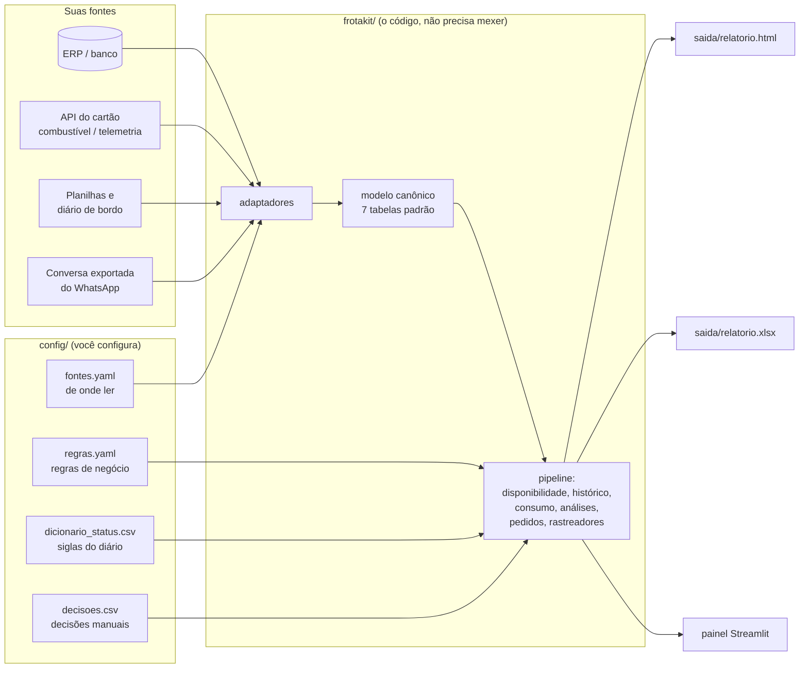

# Nota técnica — como o frota-kit funciona e como implantar na sua empresa

Esta nota é para quem vai **colocar o kit para rodar com dados reais**: o analista ou a pessoa de
TI que liga as fontes e a pessoa da frota que define as regras. Ela explica o que cada arquivo
faz, o que você precisa configurar, o que não deve mexer e onde as implantações costumam errar.

- Como cada número é calculado: [metodologia.md](metodologia.md)
- Colunas de cada tabela: [modelo-de-dados.md](modelo-de-dados.md)
- Exemplos prontos de ERP, API, planilha e WhatsApp: [integracao.md](integracao.md)
- O que o kit não resolve e o que a empresa precisa ter: [limitacoes-e-recomendacoes.md](limitacoes-e-recomendacoes.md)

---

## 1. Visão geral em uma figura



A ideia central: **toda fonte é traduzida para o mesmo modelo de dados antes de qualquer regra
rodar.** As regras não sabem se o dado veio de um ERP ou de uma planilha. Por isso a implantação
se resume a três perguntas: *onde está cada dado* (`fontes.yaml`), *qual é a regra da minha
operação* (`regras.yaml` e `dicionario_status.csv`) e *quem decide os casos que a regra não
resolve* (`decisoes.csv`).

---

## 2. Mapa dos arquivos

Legenda da coluna "Você": **configura** = obrigatório ajustar para a sua empresa;
**revisa** = vale ler e ajustar se for o caso; **não mexe** = funciona como está;
**opcional** = só se precisar estender o kit.

### Raiz do projeto

| arquivo | o que é | você |
| --- | --- | --- |
| `README.md` / `README.pt-BR.md` | Apresentação do projeto | não mexe |
| `requirements.txt` / `pyproject.toml` | Bibliotecas Python necessárias | não mexe (acrescente o driver do seu banco, se usar SQL que não seja SQLite) |
| `.env.example` | Lista das variáveis secretas (senha do banco, token da API), **sem valores** | copie para `.env` e **configura** |
| `.gitignore` | Garante que `.env`, `*.local.*`, `saida/` e dados não vão para o Git | não mexe |
| `LICENSE` | Licença Apache 2.0: uso livre, inclusive comercial | não mexe |
| `NOTICE` | Crédito ao autor; **deve acompanhar** qualquer redistribuição ou versão modificada do kit | não mexe (pode acrescentar os seus créditos abaixo) |
| `CITATION.cff` | Como citar o projeto (gera o botão "Cite this repository" no GitHub) | não mexe |
| `.github/workflows/testes.yml` | Roda os testes (inclusive a checagem de links da documentação) a cada envio ao GitHub | não mexe |
| `.github/ISSUE_TEMPLATE/` | Formulário "Conte como você usa o frota-kit" | não mexe |
| `pytest.ini` | Configuração dos testes | não mexe |

### `config/` — onde a empresa trabalha

| arquivo | o que é | você |
| --- | --- | --- |
| `fontes.yaml` | **De onde vem cada dado** e como as colunas da sua fonte se chamam. O que vem no repositório aponta para os dados fictícios. | **configura**: copie para `fontes.local.yaml` |
| `regras.yaml` | **Regras de negócio**: faixas de km/L por tipo de veículo, dias para "ocioso", status de OS que contam como abertos, ordem das regras de disponibilidade, limites dos alertas | **revisa** com a gestão de frota |
| `dicionario_status.csv` | Significado das siglas do diário de bordo (sigla, significado, grupo) | **configura** se usar diário; quem mantém é a **operação** |
| `decisoes.local.csv` *(você cria)* | Decisões manuais: ligar placa errada, ignorar linha, forçar situação | **mantém** no dia a dia (quem confere) |

### `frotakit/` — o código

| arquivo | o que faz | você |
| --- | --- | --- |
| `modelo.py` | Define as 7 tabelas padrão (veículos, OS, abastecimentos, uso, posições, pedidos, decisões), converte tipos (datas e números no padrão brasileiro, S/N, Ligado/Desligado) e **corrige placas** pela posição (O→0, I→1) | não mexe |
| `adaptadores/__init__.py` | Lê o `fontes.yaml`, chama o adaptador certo para cada fonte, renomeia colunas, troca `${VARIAVEL}` pelo valor do `.env` | não mexe |
| `adaptadores/arquivo.py` | CSV e Excel (um arquivo ou vários com `*`); detecta o separador sozinho | não mexe |
| `adaptadores/grade.py` | Planilha em grade placa × dia (diário de bordo), achando o cabeçalho onde ele estiver | não mexe |
| `adaptadores/sql.py` | Consulta em banco de dados (SQLite nativo; outros bancos via SQLAlchemy) | não mexe |
| `adaptadores/api.py` | API REST com token ou OAuth2, paginação, nova tentativa em erro 429/5xx e cópia bruta das respostas | não mexe; **opcional** escrever um adaptador próprio se a sua API for muito diferente |
| `adaptadores/whatsapp.py` | Lê formulários de pagamento numa conversa exportada do WhatsApp | não mexe |
| `regras.py` | Carrega o `regras.yaml` sobre valores padrão | não mexe |
| `decisoes.py` | Aplica as decisões manuais antes das regras e informa o status de cada uma | não mexe |
| `diario.py` | Traduz as siglas pelo dicionário e lista as siglas sem legenda | não mexe |
| `disponibilidade.py` | **Situação de cada veículo** (com motivo, confirmação e alertas), resumo por base e **histórico dia a dia** | **opcional**: criar uma regra nova (seção 6) |
| `consumo.py` | km/L real entre tanques cheios, problemas de registro, desperdício estimado | não mexe |
| `analise.py` | Comparação de motoristas (intervalo de confiança) e de preço dos postos | não mexe |
| `solicitacoes.py` | Conferência de pedidos de pagamento fora do cartão | não mexe |
| `rastreamento.py` | Última posição entre fornecedores, placa a partir de apelido; função de geocodificação (não é chamada pelo `rodar`; use se precisar) | não mexe |
| `pipeline.py` | Roda tudo na ordem certa e calcula os indicadores | não mexe |
| `relatorio.py` | Gera o HTML de arquivo único e o Excel | **opcional**: mudar títulos e abas |
| `__main__.py` | Comandos `exemplo`, `validar` e `rodar` | não mexe |

### Demais pastas

| pasta | o que é | você |
| --- | --- | --- |
| `app/streamlit_app.py` | Painel interativo com filtros, usando os mesmos cálculos | não mexe |
| `exemplos/gerar_dados.py` | Gera a frota fictícia com problemas plantados | não mexe (use para treinar a equipe) |
| `tests/` | 36 testes automáticos | rode `pytest` depois de mudar regras ou código |
| `docs/` | Esta nota, limitações e recomendações, metodologia, modelo de dados, integração e estudo de caso | leitura |
| `dados_exemplo/`, `saida/` | Criadas ao rodar; **nunca vão para o Git** | — |

---

## 3. Implantação passo a passo

### Etapa 0 — Rodar o exemplo (30 minutos)

```bash
python -m venv .venv && source .venv/bin/activate     # Windows: .venv\Scripts\activate
pip install -r requirements.txt
python -m frotakit exemplo
python -m frotakit rodar
streamlit run app/streamlit_app.py
```

Abra `saida/relatorio.html` com quem cuida da frota. Antes de ligar qualquer dado real, a equipe
precisa concordar que **as perguntas e as categorias** (Em operação, Ocioso, A confirmar,
Manutenção, Fora da frota) fazem sentido para ela.

### Etapa 1 — Inventário das fontes (1 a 2 dias)

Para cada uma das 7 tabelas, responda: *existe? onde está? quem é o dono? com que frequência é
atualizada? qual identificador do veículo ela usa?*

| tabela | obrigatória? | fonte típica numa empresa com ERP | fonte típica sem ERP |
| --- | --- | --- | --- |
| `veiculos` | **sim** | cadastro de ativos/frota do ERP | planilha de controle de frota |
| `ordens_servico` | recomendada | módulo de manutenção do ERP | planilha da oficina |
| `abastecimentos` | para consumo | API ou exportação do cartão combustível | exportação do cartão |
| `uso` | recomendada | roteirizador, TMS, check-list de saída | diário de bordo em grade |
| `posicoes` | opcional | API ou relatório da telemetria | relatório exportado do rastreador |
| `solicitacoes` | opcional | — | conversa exportada do WhatsApp, formulário |
| `decisoes` | recomendada | criada pela equipe | criada pela equipe |

Sem `veiculos`, nada roda. Com só `veiculos` e `ordens_servico` já sai a disponibilidade básica;
cada tabela a mais acrescenta um módulo.

### Etapa 2 — Segredos (`.env`)

```bash
cp .env.example .env
```

Preencha senha de banco e tokens **só** no `.env`. No YAML, eles aparecem como `${ERP_URL}`,
`${CARTAO_FROTA_TOKEN}`. Peça ao ERP um **usuário só de leitura** e, à API, o token de menor
escopo possível.

### Etapa 3 — Ligar as fontes (`config/fontes.local.yaml`)

```bash
cp config/fontes.yaml config/fontes.local.yaml
```

Para cada tabela, diga o `tipo` (arquivo, grade, sql, api, whatsapp), onde está e como as colunas
se chamam (`colunas: {nome_na_fonte: nome_do_modelo}`). Exemplos completos em
[integracao.md](integracao.md). Vá **uma tabela por vez** e valide a cada uma:

```bash
python -m frotakit validar --fontes config/fontes.local.yaml
```

O `validar` lê tudo e mostra quantas linhas vieram de cada tabela. Se faltar uma coluna
obrigatória, a mensagem diz qual e lista as colunas recebidas.

**Com ERP**, o melhor caminho é pedir à TI uma *view* por tabela já com os nomes do modelo
(`SELECT numero AS os_id, placa, dt_abertura AS abertura ...`). O mapeamento fica vazio, e a
lógica de "o que é uma OS aberta" fica num lugar só.

### Etapa 4 — Regras de negócio (`config/regras.yaml`)

Faça esta revisão **com a gestão de frota**, não sozinho:

| parâmetro | pergunta para a operação |
| --- | --- |
| `disponibilidade.status_fora_da_frota` | Quais status do cadastro significam que o veículo saiu da frota? |
| `disponibilidade.status_os_aberta` | Quais status de OS significam "o carro ainda está na oficina"? "Aguardando retirada" conta? |
| `disponibilidade.dias_ocioso` | Depois de quantos dias sem rodar um carro disponível vira problema? |
| `disponibilidade.ordem` | Se o cadastro diz "ativo" e o diário diz "M", quem ganha? |
| `consumo.grupos` | Os grupos de veículo (carro, utilitário, van, caminhão) e a faixa de km/L de cada um batem com a sua frota? O campo `grupo` do cadastro precisa usar esses mesmos nomes. |
| `analise.sobrepreco_minimo` | A partir de quanto um posto mais caro merece atenção? |

### Etapa 5 — Siglas do diário (`config/dicionario_status.csv`)

Só se você usa diário de bordo. Rode uma vez, abra a aba **"Siglas sem legenda"** e mande a lista
para a operação dizer o que cada sigla significa e em qual grupo entra (`rodou`, `manutencao`,
`parado`). Repita até a lista ficar vazia. Daí em diante, sigla nova aparece ali sozinha.

### Etapa 6 — Primeira conferência

Rode e confira com a equipe, nesta ordem:

1. **Placas fora do cadastro**: quanto maior a lista, pior a qualidade da chave. Resolva cada uma
   com uma linha em `decisoes.local.csv` (`ligar` ou `ignorar`) ou corrija na fonte.
2. **Veículos com "conflito entre fontes"** e com alertas: escolha 10 e confira à mão. Se o kit
   estiver certo, o problema está na fonte (OS esquecida, cadastro desatualizado). Se estiver
   errado, ajuste a regra.
3. **Consumo com confiança "baixa" ou "sem cálculo"**: geralmente o cartão não marca "tanque
   cheio" ou o odômetro não é digitado. Isso é processo, não código.

### Etapa 7 — Rotina

- Agende o `rodar` (cron ou Agendador de Tarefas) e publique o HTML numa pasta compartilhada ou
  suba o painel Streamlit num servidor interno.
- Defina **quem** mantém o dicionário de siglas e **quem** registra decisões.
- Uma vez por mês, revise as decisões manuais antigas: uma "situação forçada" esquecida vale para
  sempre.

---

## 4. Onde cada empresa precisa prestar atenção

### A placa é a chave

Todas as tabelas se ligam pela placa. Se uma fonte identifica o veículo por **apelido, chassi ou
código interno**, você precisa trazer a placa: na própria consulta SQL (join com o cadastro), com
`placa_de` (extrai a placa de um texto como "Van 03 - ABC-1D23") ou com uma tabela de/para.
Placa de veículo alugado ou de terceiro que não está no cadastro aparece em "Placas fora do
cadastro"; decida se ela deve entrar no cadastro.

### Cadastro (`veiculos`)

- O `grupo` precisa usar os nomes do `regras.yaml` (`carro`, `utilitario`, `van`, `caminhao`, ou
  os que você criar). Grupo desconhecido usa a faixa `padrao`, mais larga e menos útil.
- `capacidade_tanque` melhora muito o consumo (margem de erro e alerta de litros acima do tanque).
- `data_status` permite **confirmar** a baixa (nenhuma atividade depois da data).

### Ordens de serviço

- Status variam muito entre sistemas. Liste os seus e coloque os que significam "na oficina" em
  `status_os_aberta`. OS sem status **e** sem data de fechamento conta como aberta.
- OS que nunca são fechadas no sistema são a causa número 1 de "conflito entre fontes".

### Abastecimentos

- **Tanque cheio** é essencial: sem essa marcação não existe km/L confiável. Se o cartão não a
  envia, combine com os motoristas e o posto, ou o módulo de consumo não vai funcionar.
- **Odômetro digitado à mão** gera a maioria dos alertas; o kit separa erro de digitação de trecho
  rodado sem abastecer, mas a solução de longo prazo é o processo.
- Abastecimentos fora do cartão (PIX, reembolso) **não entram no consumo** a menos que também
  sejam carregados em `abastecimentos`.

### Uso / diário de bordo

- Viagem sem sigla conta como "rodou". Diário com sigla é traduzido pelo dicionário.
- A sigla do diário só vale por `diario.validade_dias` (padrão 3): diário desatualizado não
  prende carro em manutenção para sempre, mas também deixa de ajudar.

### Rastreadores

- Ignição ligada conta como atividade. Se o seu fornecedor não informa ignição, a posição serve
  só para "onde está" e "sem sinal há N dias".

### Pedidos de pagamento (WhatsApp)

- O formulário precisa ter um texto fixo no começo (o `gatilho`) e rótulos fixos (PLACA, KM...).
  Padronize o modelo de mensagem antes de ligar essa fonte.
- A conversa traz nomes e CPF: o kit descarta o CPF e não publica nada, mas trate o arquivo
  exportado como dado pessoal (LGPD).

---

## 5. Erros comuns na implantação

| sintoma | causa provável | o que fazer |
| --- | --- | --- |
| `coluna(s) obrigatória(s) ausente(s)` | mapeamento de colunas incompleto | compare a lista "Colunas recebidas" da mensagem com o `colunas:` do YAML |
| Quase toda a frota "Ociosa" | a tabela `uso` não foi ligada ou as placas não batem | rode `validar`; veja "Placas fora do cadastro" |
| Datas trocadas (dia/mês) | data em texto num formato ambíguo | exporte em `dd/mm/aaaa` ou ISO (`aaaa-mm-dd`) |
| Odômetro ou valor 1.000 vezes menor | número com ponto de milhar e vírgula decimal misturados de forma ambígua | exporte números sem separador de milhar |
| Muitos veículos "A confirmar" | dicionário de siglas incompleto | complete pela aba "Siglas sem legenda" |
| Consumo "sem cálculo" para todos | o cartão não envia "tanque cheio" | ver seção 4, Abastecimentos |
| `Variável de ambiente ... não definida` | segredo ausente no `.env` | preencha o `.env` (nunca o YAML) |

---

## 6. Estendendo o kit

**Uma fonte que nenhum adaptador lê** (por exemplo, uma API com autenticação própria): crie
`frotakit/adaptadores/minha_fonte.py` com uma função `ler(cfg, base) -> DataFrame` que devolva as
colunas do modelo, registre-a em `LEITORES` no `adaptadores/__init__.py` e use `tipo: minha_fonte`
no YAML.

**Uma regra de disponibilidade nova** (por exemplo, "veículo sem licenciamento"): em
`disponibilidade.calcular`, escreva uma função `regra_x(r)` que devolve `(situação, categoria,
motivo)` ou `None`, registre-a no dicionário `funcoes` e coloque o nome dela na
`disponibilidade.ordem` do `regras.yaml`, na posição de prioridade desejada. Escreva um teste.

**Uma aba nova no relatório**: acrescente a tabela ao resultado em `pipeline.py` e uma linha em
`ABAS` no `relatorio.py`.

Depois de qualquer mudança: `pytest`.
